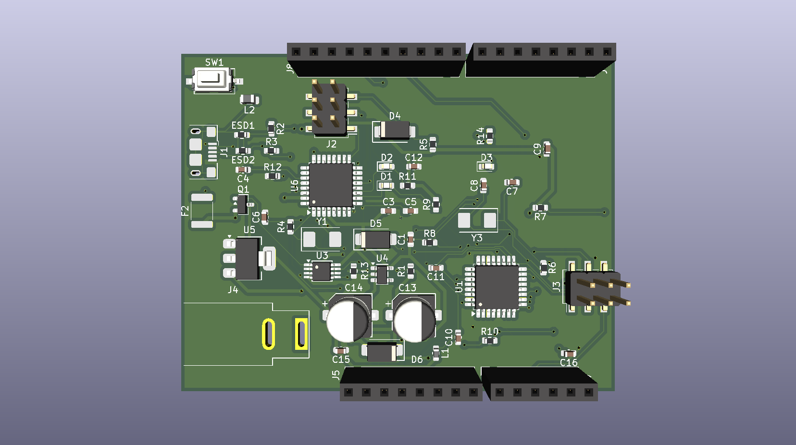

# Custom ATmega328PB Development Board 

A custom-designed development board built from scratch in **KiCad EDA**, based on the ATmega328PB microcontroller architecture and the classic Arduino Uno reference design. 

This project was created as a practical hands-on hardware engineering task to master schematic capture, SMD component placement, USB-to-UART interface integration, power regulation, and manufacturing output preparation.

---

## 3D Render & Hardware Preview

---

## Hardware Specifications & Key Features

* **Primary Microcontroller:** ATmega328PB-AU (TQFP-32 package)
* **USB-to-Serial Converter:** ATmega16U2-A with 16MHz Crystal Oscillator
* **Power Management:** 
  * NCP1117-5.0 LDO regulator for 5V main rail
  * LP2985-3.3 regulator for 3.3V power output
  * DC Barrel Jack & USB Micro (USB_B_Micro) input protection
* **ESD & Circuit Protection:** ESD protection array (CG00603MLC-05E) and resettable PTC fuse (MF-MSMF050-2)
* **Operational Amplifiers:** LMV358 for power source switching / indicator circuit
* **Programming Interfaces:** AVR-ISP-6 headers for direct flashing via ICSP
* **Design Tools:** KiCad EDA (Schematics, PCB Layout, Gerber generation, BOM export)

---

## Repository Content

* `arduino-board-pcb.kicad_sch` — Schematic source file
* `arduino-board-pcb.kicad_pcb` — PCB layout source file
* `arduino-board-pcb.kicad_pro` — KiCad main project file
* `arduino-board-pcb.csv` — Full Bill of Materials (BOM) with precise component specifications
* `pcb-arduino-gbr.rar` — Production-ready Gerber files
* `/images/board_3d.png` — 3D visualization render

